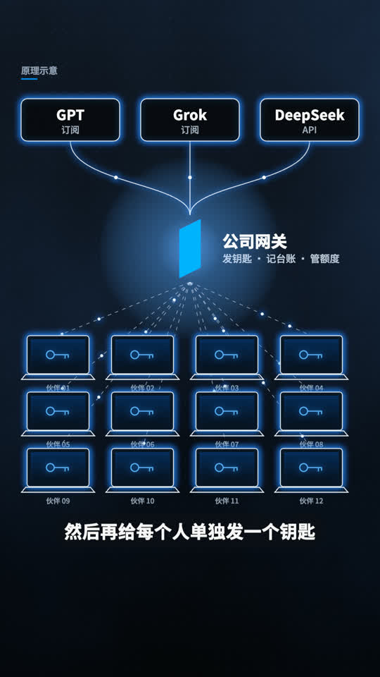
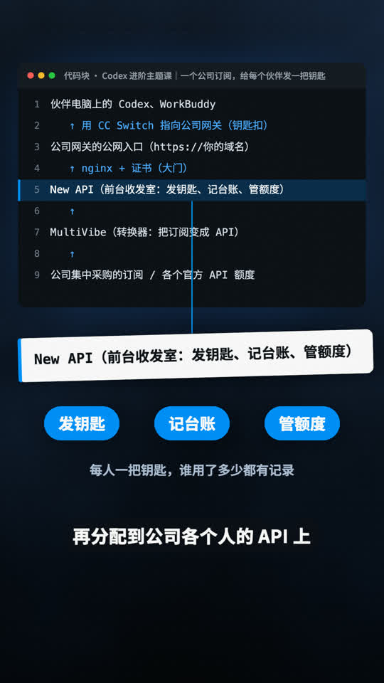

# EvenBetter Motion · 半斤九两动效系统

把一条竖屏口播剪成 2–3 分钟、带代码动效的知识分享短视频。画面全部由代码按时间算出来：真人口播在白墙前，讲到原理和数据时进入深色代码世界，真实录屏放进圆角小窗当证据，人留在圆角画中画里继续讲。

<p>


</p>

这是 [汤九两](https://github.com/FloydTang) 为自己账号做的剪辑系统，第一条用它做完的片子是《一个公司订阅，给每个伙伴发一把钥匙》。现在整理出来，Claude Code、Codex 或其他编程助手都可以读懂并照着做。

## 它和剪辑模板有什么不同

- **写时间线，不拖素材。** 一条片子就是一份 `timeline.js`：几点几秒出现大字、手写批注、线稿原理图、录屏小窗。改一行，重新渲染就行。
- **特效是自己写的。** 蓝窗转场、线稿世界、手写批注、代码块逐步高亮、圆角画中画，都在 `engine/` 里，不依赖第三方模板。
- **真实录屏当证据。** 主画面用代码重画真实数字，旁边放真实录屏小窗，标“真实后台录屏”。
- **规矩写在文档里。** 什么内容配什么画面、声音怎么混、隐私怎么查，都在 `docs/style-guide.md`，助手照着做，风格就不会跑偏。

## 快速开始

需要：Node 18+、Google Chrome、ffmpeg、Python 3.10+（`numpy scipy`，听写还要 `funasr`）。

```bash
git clone https://github.com/FloydTang/evenbetter-motion.git
cd evenbetter-motion
npm ci
cp -r episodes/_template episodes/20261201-我的第一条
# 把口播视频放到 episodes/20261201-我的第一条/raw/talk.mp4，录屏放 raw/screen.mov
```

然后按 [`SKILL.md`](SKILL.md) 的流程走：听写 → 校字 → 剪辑表 → 抠像 → 切录屏 → 写时间线 → 出样张 → 混音 → 渲染成片。

只想先看引擎能不能跑：

```bash
node tools/render.mjs <episode> --stills 1.0,5.0 --still-dir /tmp/stills
```

## 给编程助手用

| 工具 | 怎么用 |
|---|---|
| Claude Code | 把仓库放到 `~/.claude/skills/evenbetter-motion/`，或者在项目里直接打开，它会读 `SKILL.md` |
| Codex | 在仓库目录里打开，它会读 `AGENTS.md` |
| 其他助手 | 让它先读 `SKILL.md`、`docs/style-guide.md`、`docs/timeline.md` |

## 目录

```
SKILL.md              成片标准和制作流程（助手的入口）
AGENTS.md             给 Codex 等助手的简短说明
docs/style-guide.md   风格规范：固定元素、画面怎么选、声音、隐私清单
docs/timeline.md      episode.json 和 timeline.js 的全部字段
docs/lessons.md       踩过的坑
engine/               渲染引擎：core（合成）、fxlib（特效库）、timeline（时间线渲染）
tools/                听写、字幕对齐、抠像、录屏切片、混音、渲染
audio/                CC0 音效和混音脚本
episodes/_template/   新片子的模板
examples/             第一条试点片的完整代码（只有代码，没有素材）
```

## 名字

EvenBetter 来自半斤九两 logo 下的英文 “EVEN BETTER”。

## 许可

代码 MIT。字体是 SIL OFL，音效是 CC0，详见 [`NOTICE.md`](NOTICE.md)。“半斤九两”名称和 logo 不在授权范围内。
